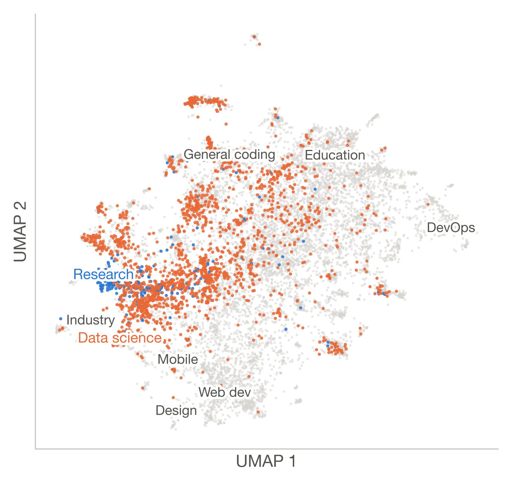
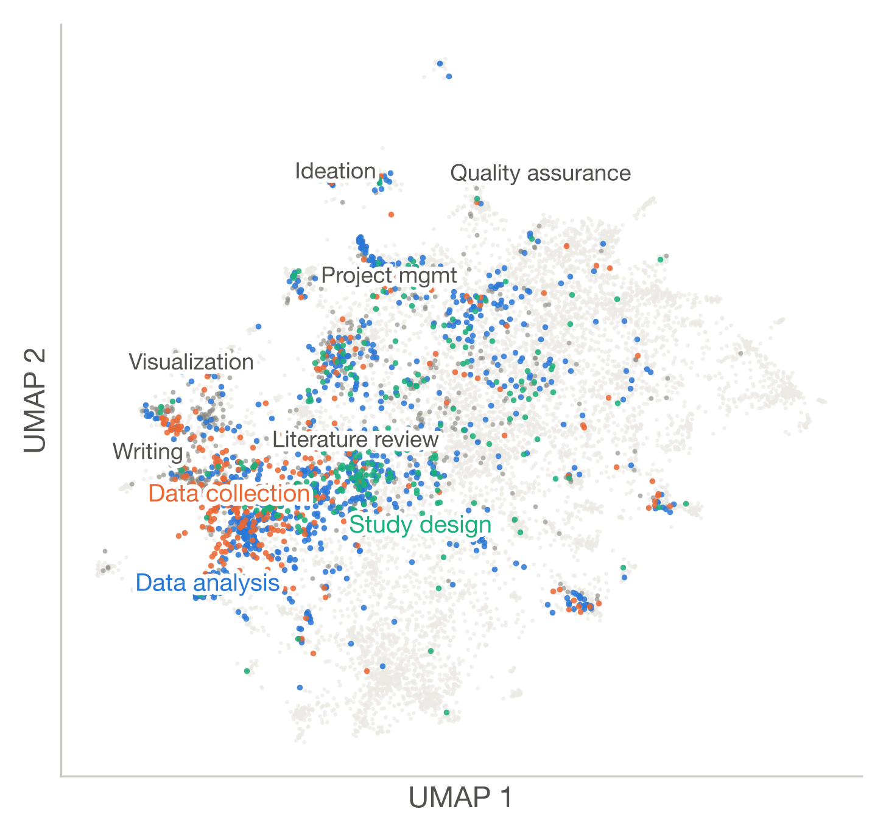

# SciSkillBank: A Dataset of Claude Code Skills for Scientific Research

Data for the paper of the same title by Fan Huang and Kai-Cheng Yang. SciSkillBank is a
dataset of 2,200 research-relevant GitHub repositories of Claude Code skills, with LLM
annotations of research workflow stage, methodology encoding and intended AI autonomy. This
repository holds the dataset, the summary embeddings, the label tables of the perturbation
experiments, and the scripts that regenerate Figures 2 and 4.

<p align="center">
  
  
</p>

Figure 2: Embedding landscape of 11,613 valid repository summaries, projected with UMAP
(cosine distance, 15 neighbors, minimum distance 0.1). Left: full landscape with research and
data-science repositories highlighted. Right: research-relevant corpus colored by primary
workflow stage. Summaries take broad domain as an input, so the layout is not independent
evidence of domain structure, and axes and distances carry no quantitative meaning.

## Contents

| Path | What it is |
|---|---|
| `dataset/` | The released corpus, the UMAP tables, the 3,072-dimensional summary embeddings, the skill-file retrieval checks and the perturbation label tables. Column dictionary in `dataset/README.md` |
| `figures/` | The scripts that regenerate Figures 2 and 4, and Figure 2 as PDF and PNG. See `figures/README.md` |
| `REDACTIONS.json` | Which personal email address was replaced, and where |
| `requirements.txt` | Python dependencies |

## Quick start

```bash
pip install -r requirements.txt
python3 figures/fig2_umap.py                 # Figure 2, from dataset/sciskillbank_umap_all_candidates.csv
./figures/make_figs.sh                       # Figure 4, from dataset/instability/
```

Neither needs a network connection, a GPU or an API key.

```python
import pandas as pd

df = pd.read_csv("dataset/sciskillbank_repositories.csv")
df = df[df["record_valid"]]                          # 2,199 usable records
df["autonomy_level"].value_counts()
df["workflow_stages"].str.split(",").explode().value_counts()
```

Filter on `record_valid`: one record's summary is an API error string, so its summary-based
labels are invalid. The labels are model outputs, and the paper reports how far they move under
changes of prompt, model and input (Section 5.3 and Appendices A.6 to A.8); read those results
before using the labels record by record.

## How this release was filtered

This repository holds the data and the Figure 4 script from the paper's supplementary material,
plus the summary embeddings and the Figure 2 script, which the supplementary material did not
include. The following were left out:

- The code behind the paper's annotations and experiments, and the blinded validation
  instrument described in the paper's Future Work.
- Raw API request and response logs, API cost and budget records, credentials and `.env`
  files. No API key, token or account identifier appears in any file.
- Notebooks. The figure scripts are plain Python.
- The collected third-party skill-file text (629 MB).
- The research-only embedding run behind `dataset/sciskillbank_umap_research.csv`, which no
  figure in the paper uses; the released embeddings are the 11,613-row run behind Figure 2.
- Working notes, drafts and exploratory analyses that the paper does not report.

Repository owner names are kept, because public GitHub repository identity is the data under
study, and every record links to its public source. One personal email address, in the
`description` field of one repository in the released corpus, was replaced with the literal
string `[email redacted]`; `REDACTIONS.json` records where.

## Provenance of the upstream artifacts

The original summarization requests and the resolved model snapshot were not recovered, as the
paper states, so the summaries cannot be regenerated exactly. What survives is pinned: each
manifest in `dataset/instability/manifests/` records SHA-256 digests of the nine artifacts the
domain-field sensitivity runs read (the README checkpoint, the research-only and all-candidate
summary checkpoints, the annotation checkpoint, the two source notebooks and the derived
tables). The three manifests were written independently and their digests agree.

## License

CC BY 4.0 for the authors' contributions, data and code alike; see `LICENSE`. The license does
not extend to third-party content. 957 of the 2,200 repositories carry no license field and a
further 107 carry NOASSERTION, so repository metadata is not relicensed: content at each linked
repository remains governed by that repository's own license.
